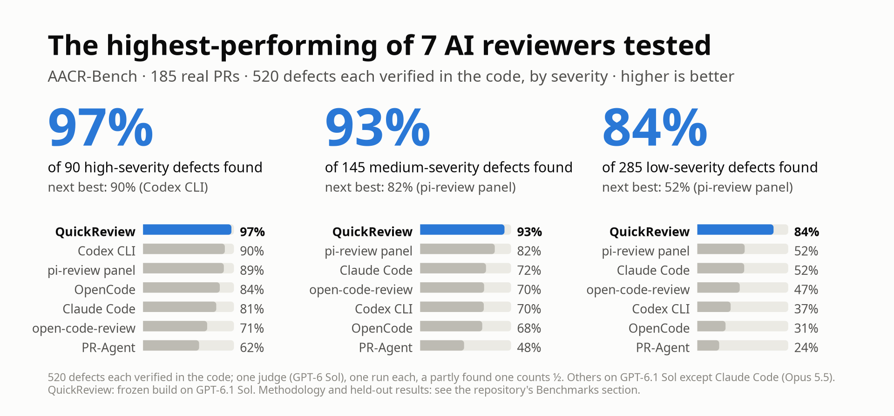
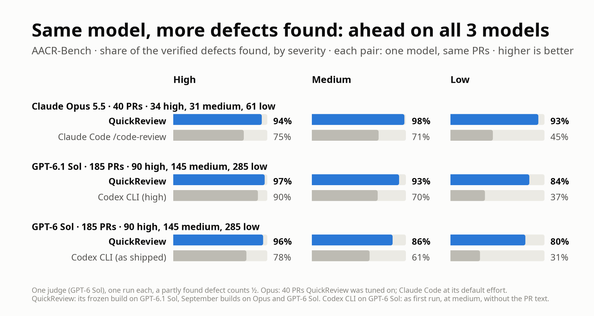
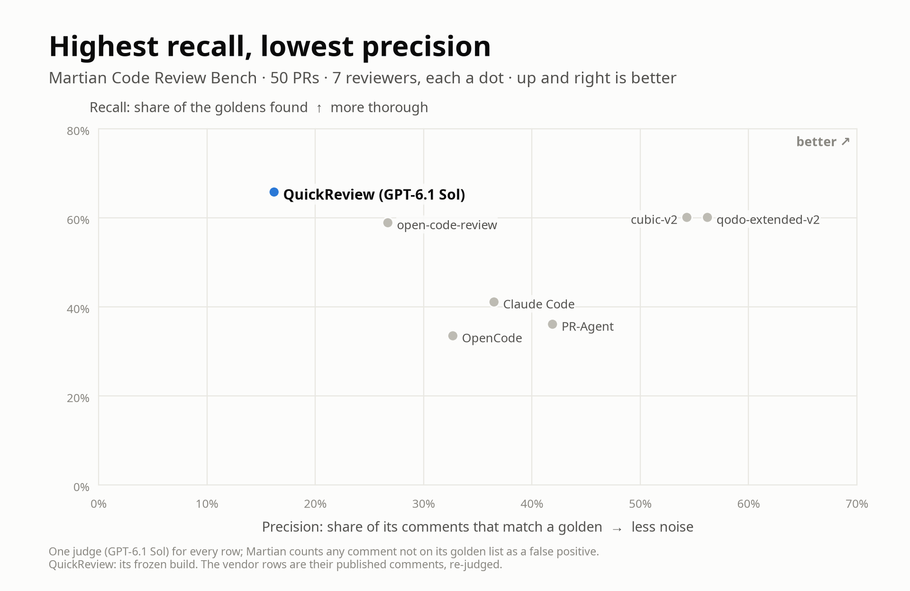
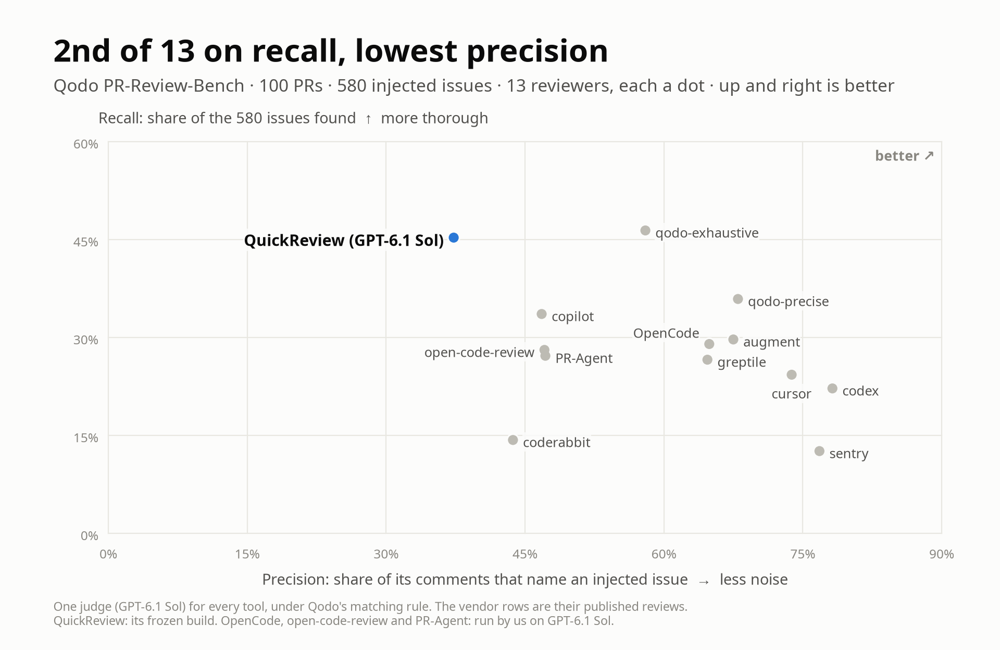
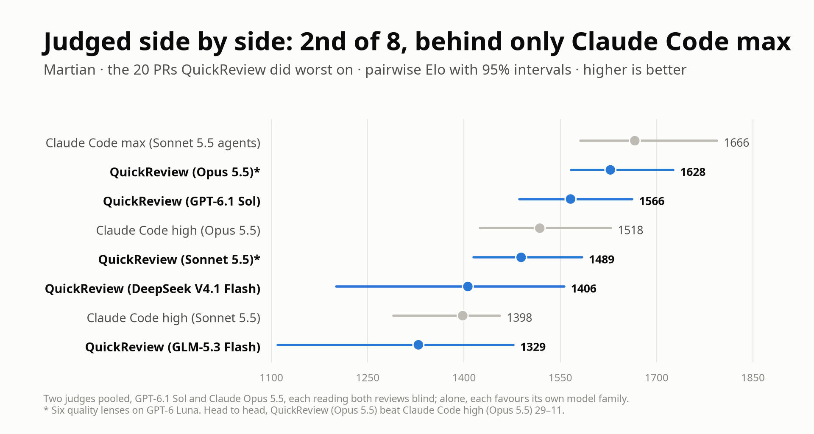

# Benchmarks

This page holds every benchmark result for QuickReview: the charts, the
tables, the pull requests kept out of tuning, and what a review cost. The
short version is in the [README](README.md#benchmarks). The first chart is
the headline result, and the text below it says how each result was
measured and where QuickReview is weaker.

<picture>
  <source media="(prefers-color-scheme: dark)" srcset="docs/media/bench-hero-dark.png">
  
</picture>

Recall is the headline: a review that misses the defect has failed, whatever
else it does. Precision, cost and time are shown beside it, because that is
where QuickReview pays. Unless a chart or table names another build or model,
its results are the frozen build of 2026-10-04 on `gpt-6.1-sol`, shipped
defaults, one review per PR. The third-party tools we ran used the best
configuration we found for each (except Claude Code, which ran `/code-review`
at its default effort and was not varied), the OpenAI-based ones on the same
model, under the same judge on the same PRs. Every run behind these results
is public, with its reviews, verdicts and answer key, in the Hugging Face
dataset [quickchatai/quickreview-bench](https://huggingface.co/datasets/quickchatai/quickreview-bench)
(DOI [10.57967/hf/11598](https://doi.org/10.57967/hf/11598)), and each number can be recomputed from it.

**AACR-Bench, verified defects.** AACR-Bench's own reference comments are
mostly not real problems, so we built a key of 520 defects, each verified in
the code and graded by its consequence: **high** would block a merge (a
user-visible bug on a normal path, a crash, data loss, a security hole, a
broken build), **medium** should be fixed before merge, **low** is real but
fine as a follow-up. The chart at the top is this key. QuickReview misses 2.5
of the 90 high-severity defects, 10.5 of the 145 medium and 46 of the 285 low
(a partly found defect counts as half); the best other reviewer at each
severity misses 9, 26 and 136.5. Over the panel and Codex CLI the
high-severity lead holds under a paired bootstrap (+8.3 points [+1.9, +14.6]
over the panel). The price: 6.9 comments per PR, 42% of them true but minor.

<picture>
  <source media="(prefers-color-scheme: dark)" srcset="docs/media/bench-same-model-dark.png">
  
</picture>

**Same model, two reviewers.** With the model held fixed, QuickReview still
finds more than the model maker's own reviewer on each of the three models
where we ran both, at 11 to 20 times the cost ($3.24 against $0.16 per PR on
Opus). This contrasts two tools, not a measured design effect: they also
differ in budget and inputs, Claude Code ran `/code-review` at its default
effort, and the Opus and GPT-6 Sol rows are September builds of QuickReview.

<picture>
  <source media="(prefers-color-scheme: dark)" srcset="docs/media/bench-martian-dark.png">
  
</picture>

**Martian, 50 PRs.** Martian scores against about three "golden" comments
per PR and counts every other comment as a false positive. It extracts about
12.8 issues per PR from QuickReview's reviews, so QuickReview has the highest
recall and the lowest precision. We
audited the goldens: of the 86 that describe a real defect the PR
introduces, it finds 75 (87%), the most of the seven reviewers judged alike.

<picture>
  <source media="(prefers-color-scheme: dark)" srcset="docs/media/bench-qodo-dark.png">
  
</picture>

**Qodo PR-Review-Bench, 100 PRs.** 580 injected issues: 309 functional bugs
and 271 violations of rules written in the repo. QuickReview finds the most
functional bugs of the thirteen tools (52.1%) and the second-most issues
overall, at the lowest precision; it is fourth on F1.

<picture>
  <source media="(prefers-color-scheme: dark)" srcset="docs/media/bench-elo-dark.png">
  
</picture>

**Judged side by side.** A pairwise judge reads two reviews of the same PR
blind and picks the better one. GPT-6.1 Sol and Claude Opus 5.5 both judged,
and a Bradley-Terry fit over their 596 verdicts gives Elo; alone, the two
judges pick the same winner only 56% of the time, which is why they are
pooled. On the 20 Martian PRs where QuickReview on GPT-6.1 Sol or DeepSeek did
worst, QuickReview on Opus 5.5 (six of its lenses on GPT-6 Luna) beat Claude
Code's `/code-review` at high effort on Opus 5.5 in 29 of 40 verdicts, at more
than ten times its cost ($4.61 per PR on average). Only Claude Code's max mode (Opus
5.5 directing Sonnet 5.5 agents, about $20 per PR) ranks higher, by a margin
inside the intervals. Every judgment, with both judges' reasoning, is in the
dataset's `elo_judgments` table.

**Other models.** QuickReview runs on any model provider pi supports, on the
credential you already have. On AACR-Bench
it holds most of its recall on cheap open models, and it falls apart on a
weak one:

| QuickReview on | PRs | High (90) | Medium (145) | Low (285) | All (520) | Mean $/PR | Judge |
|---|---|---|---|---|---|---|---|
| GPT-6.1 Sol (frozen build) | 185 | 87.5 (97%) | 134.5 (93%) | 239 (84%) | 461 (89%) | 2.06 | gpt-6-sol |
| DeepSeek V4.1 Flash (mostly low effort) | 185 | 83 (92%) | 131 (90%) | 237.5 (83%) | 451.5 (87%) | 0.74 | gpt-6.1-sol |
| GLM-5.3 Flash | 185 | 83 (92%) | 120.5 (83%) | 231.5 (81%) | 435 (84%) | 0.52 | gpt-6.1-sol |
| GPT-6 Luna | 185 | 39 (43%) | 44 (30%) | 64 (22%) | 147 (28%) | 0.04 | gpt-6-sol |
| Claude Opus 5.5 | 40 | 32/34 (94%) | 30.5/31 (98%) | 57/61 (93%) | 119.5/126 (95%) | 3.24 | gpt-6-sol |

The best third-party reviewer at each severity finds 81 of 90 high (Codex
CLI), 119 of 145 medium and 148.5 of 285 low (both the pi-review panel). The
open-model rows ran a later build (mid-October, with cost changes made after
the freeze) and a later judge; DeepSeek ran at low reasoning effort on 143 of
its PRs and lost one lens pass on 5 PRs. On GLM, one lens pass was lost on 1 PR
and the validator on 2, and on 7 more a lens pass ran but is missing from the
review's record of executed passes. The GPT-6 Luna and
Opus rows ran a September build; on the same 40 PRs as Opus, the frozen
GPT-6.1 Sol build finds 33 of 34 high, 28 of 31 medium and 44 of 61 low. Read
the table as directional. The open-model runs, their reviews and their
verdicts are in the [dataset](https://huggingface.co/datasets/quickchatai/quickreview-bench).

The full tables

**AACR-Bench** (185 PRs, 10 languages, 520 verified defects; a partly found defect counts ½)

| Reviewer | High (90) | Medium (145) | Low (285) | All (520) | Comments correct | Mean $/PR | Median min/PR |
|---|---|---|---|---|---|---|---|
| **QuickReview** | **87.5 (97%)** | **134.5 (93%)** | **239 (84%)** | **461 (89%)** | 92% | 2.06 | 17.5 |
| pi-review panel (high) | 80 (89%) | 119 (82%) | 148.5 (52%) | 347.5 (67%) | 89% | 0.27 | 1.8 |
| Claude Code (Opus 5.5) | 72.5 (81%) | 105 (72%) | 147 (52%) | 324.5 (62%) | 81% | 0.20 | 0.7 |
| open-code-review (high) | 63.5 (71%) | 102 (70%) | 133 (47%) | 298.5 (57%) | 86% | 0.53 | 1.8 |
| Codex CLI (high) | 81 (90%) | 101.5 (70%) | 104.5 (37%) | 287 (55%) | 93% | 0.14 | 2.1 |
| OpenCode (+ PR text) | 76 (84%) | 99 (68%) | 88.5 (31%) | 263.5 (51%) | 93% | 0.17 | 2.3 |
| PR-Agent | 55.5 (62%) | 70 (48%) | 68.5 (24%) | 194 (37%) | 76% | 0.07 | 1.9 |

**Martian** (50 PRs, Core; one `gpt-6.1-sol` judge for every row, the vendor rows re-judged from their published comments)

| Tool | Precision | Recall | F1 | F2 | Real goldens (86) | Mean $/PR | Mean min/PR |
|---|---|---|---|---|---|---|---|
| **QuickReview** | 16.2 | **65.8** | 26.1 | 40.9 | **75 (87%)** | 2.84 | 26.1 |
| qodo-extended-v2 | 56.2 | 60.1 | **58.1** | **59.3** | 68 (79%) | – | – |
| cubic-v2 | 54.3 | 60.1 | 57.1 | 58.9 | 58 (67%) | – | – |
| open-code-review | 26.7 | 58.9 | 36.8 | 47.4 | 67 (78%) | 0.86 | 3.3 |
| PR-Agent | 41.9 | 36.1 | 38.8 | 37.1 | 46 (53%) | 0.09 | 1.4 |
| claude-code | 36.5 | 41.1 | 38.7 | 40.1 | 45 (52%) | – | – |
| OpenCode | 32.7 | 33.5 | 33.1 | 33.4 | 48 (56%) | 0.19 | 2.4 |

**Qodo PR-Review-Bench** (100 PRs; one `gpt-6.1-sol` judge under Qodo's stated matching rule; five more vendors are in the paper)

| Tool | Comments/PR | Precision | Recall | F1 | Functional recall | Rule recall | Mean $/PR | Mean min/PR |
|---|---|---|---|---|---|---|---|---|
| qodo-exhaustive | 4.6 | 58.0 | **46.4** | **51.5** | 48.2 | **44.3** | – | – |
| qodo-precise | 3.1 | 68.0 | 35.9 | 47.0 | 36.2 | 35.4 | – | – |
| augment | 2.5 | 67.5 | 29.7 | 41.2 | 49.2 | 7.4 | – | – |
| **QuickReview** | 7.1 | 37.3 | 45.3 | 40.9 | **52.1** | 37.6 | 2.48 | 19.6 |
| OpenCode | 2.6 | 64.9 | 29.0 | 40.0 | 43.7 | 12.2 | 0.20 | 2.3 |
| copilot | 4.2 | 46.8 | 33.6 | 39.1 | 46.3 | 19.2 | – | – |
| open-code-review | 3.5 | 47.1 | 28.1 | 35.2 | 45.6 | 8.1 | 0.46 | 1.9 |
| PR-Agent | 3.4 | 47.2 | 27.2 | 34.5 | 43.7 | 8.5 | 0.10 | 1.2 |

**Tuning and held-out PRs.** The last tuning round was mined from misses on
part of each benchmark, including 145 of the 185 AACR-Bench PRs. The 40 PRs
in the Opus comparison were used to tune its September build. On the PRs
kept out of the last tuning round, the frozen build finds 83% of AACR-Bench's
defects (20 PRs), against the next best 72%, ties qodo-extended-v2 on Martian's
real goldens (43 of 52, 30 PRs), and on Qodo (31 PRs) reaches 60.3% recall and
F1 53.0, level with qodo-exhaustive's 51.3.

**Read more.** Two papers carry the method, every table and the threats to
validity: [*Measuring whether a code review finds the real
defects*](bench/aacr/paper/benchmark.pdf) and [*QuickReview: a multi-pass
automated code reviewer*](bench/aacr/paper/quickreview.pdf).
Every run behind these numbers is published as the Hugging Face dataset
[quickchatai/quickreview-bench](https://huggingface.co/datasets/quickchatai/quickreview-bench): the answer
key, every review and verdict, the Elo judgments, and the run directories
with a numbers-only extract in place of each raw session log. [`bench/aacr/recompute/`](bench/aacr/recompute/README.md)
rebuilds each number from it with no model call, and
[`bench/aacr/README.md`](bench/aacr/README.md#reproduce) shows how to
re-score the runs with no keys, re-judge them with our judge or
[your own](bench/aacr/README.md#re-judge-with-your-own-judge), or re-run the
benchmark on your own keys. Costs are list
prices; on a subscription plan they are quota, not a bill. The charts are drawn
by `bench/aacr/showcase/readme_charts.py`.

## What a review cost

On AACR-Bench a review averaged $2.06 per PR at list prices (median
$1.87); on Martian's and Qodo's PRs, $2.84 and $2.48. Those figures are
GPT-6.1 Sol's; another model costs what its own prices and token use make
it.
