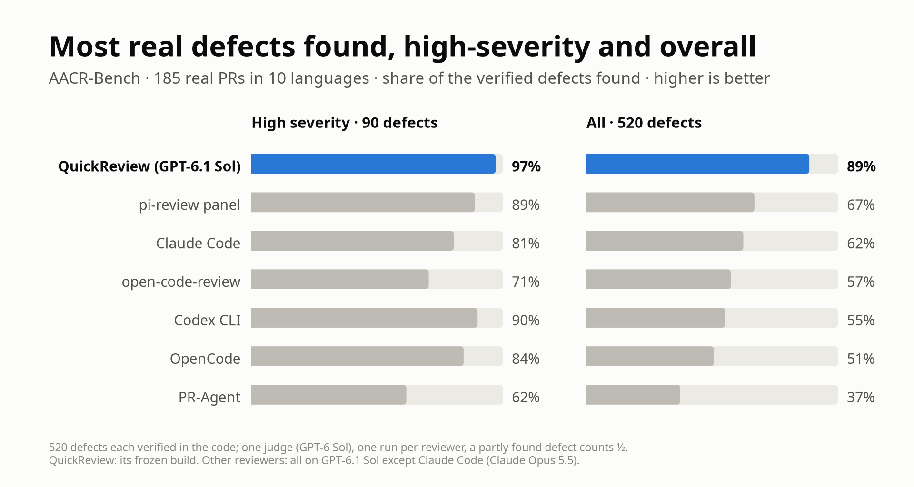
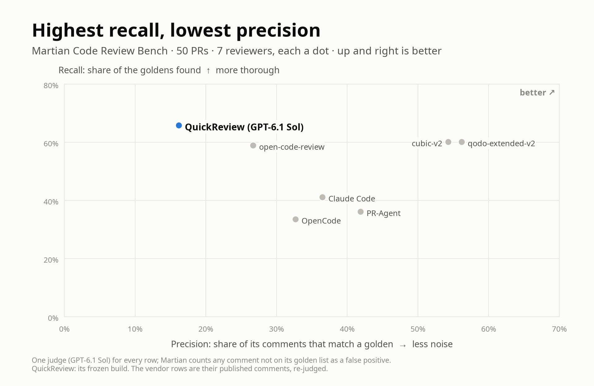
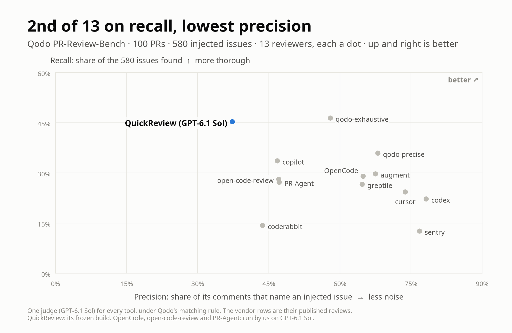

<h1 align="center">QuickReview</h1>

<p align="center">
  <b>A self-hosted AI code reviewer for GitHub pull requests: many narrow reviewers, one verified review.</b>
</p>

<p align="center">
  <a href="https://github.com/quickchatai/quickreview/actions/workflows/ci.yml"></a>
  <a href="https://www.npmjs.com/package/@quickchatai/quickreview"></a>
  <a href="https://github.com/quickchatai/quickreview/releases/latest"></a>
  <a href="LICENSE"></a>
</p>

A single model asked to "review this PR" reads the diff once, from one angle,
and stops when it has found something worth saying. QuickReview fans each
change out to **a dozen or so narrow, read-only lens passes** that each look
for one kind of problem and never see each other's output. It merges their
findings so one root cause gets one comment, and an **adversarial validator
re-derives every candidate from the code** before one review is posted.

<p align="center">
  
</p>

On 185 real PRs with 520 defects each verified in the code, it finds
**97% of the high-severity defects and 89% of all of them**; the strongest
third-party configuration we measured finds 67%. That recall costs more:
about $2 and 17 minutes per PR, where the other tools take $0.07–0.53 and
0.7–2.3 minutes ([Benchmarks](#benchmarks)).

Around the review sits a small, deterministic TypeScript daemon with no LLM
in its decision path. It takes GitHub App webhooks, runs an authoritative
reconcile poll, keeps one sticky [pi](https://github.com/earendil-works/pi)
session per PR, and posts as *your* GitHub App through one gated mutation
path, on your infrastructure, under your keys.

**Status: beta.** The reviewer has run continuously since mid-August 2026 on
a busy commercial repository. The packaging for other teams is young: expect
rough edges in setup. `dry_run = true` is the shipped default, so a fresh
install never posts anything.

## How a review works

1. **Plan the lenses by rule.** Plain code, not a model, reads the changed
   files and the PR text and plans the passes, each with the reason it was
   planned. The PR's session may add a lens or raise its reasoning tier, with
   a stated reason; it may never drop one.
2. **Fan out isolated lenses.** Each pass is a leaf agent with read-only
   tools, the diff and a worktree at the exact head. None can see another
   pass, spawn agents, or run your code. `pass-baseline` and `pass-tests` run
   on every code change, `pass-sweep` reads every changed file line by line,
   and the rest are picked by path, content and size: behaviour delta, code
   quality, intent against the PR text, backward compatibility, security,
   data safety, concurrency, bounds, rollout and more.
3. **Merge duplicates.** One root cause becomes one comment anchored at its
   cause, with the other sites in its body
   ([docs/duplicate-merge.md](docs/duplicate-merge.md)).
4. **Validate.** `pass-validate` re-reads the code for every candidate and
   keeps, demotes, doubts or kills it from a closed vocabulary. A plausible
   but wrong finding costs more than a missed nit.
5. **Post one review.** Severities map to tags by fixed rules (any surviving
   blocker means REQUEST_CHANGES), the review posts through the gate, and
   every candidate, posted or not, lands in a per-finding reasoning record.

The lens catalogue, with each lens's trigger and severity cap, is §3.3 of the
[QuickReview report](bench/aacr/paper/quickreview.pdf).

## Benchmarks

Recall is the headline: a review that misses the defect has failed, whatever
else it does. Precision, cost and time are shown beside it, because that is
where QuickReview pays. Its results are the frozen build of 2026-10-04 on
`gpt-6.1-sol`, shipped defaults, one review per PR. The third-party tools we
ran used the best configuration we found for each, the OpenAI-based ones on
the same model, under the same judge on the same PRs.

<picture>
  <source media="(prefers-color-scheme: dark)" srcset="docs/media/bench-aacr-dark.png">
  
</picture>

**AACR-Bench, verified defects.** AACR-Bench's own reference comments are
mostly not real problems, so we built a key of 520 defects, each verified in
the code, and a judge for it. Over the panel and Codex CLI the lead holds
under a paired bootstrap on high and on high + medium defects (+8.3 points
[+1.9, +14.6] on high over the panel). The price: 6.9 comments per PR, 42%
of them true but minor.

<picture>
  <source media="(prefers-color-scheme: dark)" srcset="docs/media/bench-martian-dark.png">
  
</picture>

**Martian, 50 PRs.** Martian scores against about three "golden" comments
per PR and counts every other comment as a false positive. It extracts about
12.8 issues per PR from QuickReview's reviews, so QuickReview has the highest
recall and the lowest precision. We
audited the goldens: of the 86 that describe a real defect the PR
introduces, it finds 75 (87%), the most of any tool.

<picture>
  <source media="(prefers-color-scheme: dark)" srcset="docs/media/bench-qodo-dark.png">
  
</picture>

**Qodo PR-Review-Bench, 100 PRs.** 580 injected issues: 309 functional bugs
and 271 violations of rules written in the repo. QuickReview finds the most
functional bugs of the thirteen tools (52.1%) and the second-most issues
overall, at the lowest precision; it is fourth on F1.

<details>
<summary>The full tables</summary>

**AACR-Bench** (185 PRs, 10 languages, 520 verified defects; a partly found defect counts ½)

| Reviewer | High (90) | High + medium (235) | All (520) | Comments correct | $/PR | Median min/PR |
|---|---|---|---|---|---|---|
| **QuickReview** | **87.5 (97%)** | **222 (94.5%)** | **461 (89%)** | 92% | 2.06 | 17.5 |
| pi-review panel (high) | 80 (89%) | 199 (85%) | 347.5 (67%) | 89% | 0.27 | 1.8 |
| Claude Code (Opus 5.5) | 72.5 (81%) | 177.5 (76%) | 324.5 (62%) | 81% | 0.20 | 0.7 |
| open-code-review (high) | 63.5 (71%) | 165.5 (70%) | 298.5 (57%) | 86% | 0.53 | 1.8 |
| Codex CLI (high) | 81 (90%) | 182.5 (78%) | 287 (55%) | 93% | 0.14 | 2.1 |
| OpenCode (+ PR text) | 76 (84%) | 175 (74%) | 263.5 (51%) | 93% | 0.17 | 2.3 |
| PR-Agent | 55.5 (62%) | 125.5 (53%) | 194 (37%) | 76% | 0.07 | 1.9 |

**Martian** (50 PRs, Core; one `gpt-6.1-sol` judge for every row, the vendor rows re-judged from their published comments)

| Tool | Precision | Recall | F1 | F2 | Real goldens (86) | $/PR | min/PR |
|---|---|---|---|---|---|---|---|
| **QuickReview** | 16.2 | **65.8** | 26.1 | 40.9 | **75 (87%)** | 2.84 | 26.1 |
| qodo-extended-v2 | 56.2 | 60.1 | **58.1** | **59.3** | 68 (79%) | – | – |
| cubic-v2 | 54.3 | 60.1 | 57.1 | 58.9 | 58 (67%) | – | – |
| open-code-review | 26.7 | 58.9 | 36.8 | 47.4 | 67 (78%) | 0.86 | 3.3 |
| PR-Agent | 41.9 | 36.1 | 38.8 | 37.1 | 46 (53%) | 0.09 | 1.4 |
| claude-code | 36.5 | 41.1 | 38.7 | 40.1 | 45 (52%) | – | – |
| OpenCode | 32.7 | 33.5 | 33.1 | 33.4 | 48 (56%) | 0.19 | 2.4 |

**Qodo PR-Review-Bench** (100 PRs; one `gpt-6.1-sol` judge under Qodo's stated matching rule; five more vendors are in the paper)

| Tool | Comments/PR | Precision | Recall | F1 | Functional recall | Rule recall | $/PR | min/PR |
|---|---|---|---|---|---|---|---|---|
| qodo-exhaustive | 4.6 | 58.0 | **46.4** | **51.5** | 48.2 | **44.3** | – | – |
| qodo-precise | 3.1 | 68.0 | 35.9 | 47.0 | 36.2 | 35.4 | – | – |
| augment | 2.5 | 67.5 | 29.7 | 41.2 | 49.2 | 7.4 | – | – |
| **QuickReview** | 7.1 | 37.3 | 45.3 | 40.9 | **52.1** | 37.6 | 2.48 | 19.6 |
| OpenCode | 2.6 | 64.9 | 29.0 | 40.0 | 43.7 | 12.2 | 0.20 | 2.3 |
| copilot | 4.2 | 46.8 | 33.6 | 39.1 | 46.3 | 19.2 | – | – |
| open-code-review | 3.5 | 47.1 | 28.1 | 35.2 | 45.6 | 8.1 | 0.46 | 1.9 |
| PR-Agent | 3.4 | 47.2 | 27.2 | 34.5 | 43.7 | 8.5 | 0.10 | 1.2 |

</details>

**Held-out PRs.** The last tuning round was mined from misses on part of
each benchmark. On the PRs kept out of it, the frozen build finds 83% of
AACR-Bench's defects (20 PRs), ties qodo-extended-v2 on Martian's real
goldens (43 of 52, 30 PRs), and reaches 60.3% recall and F1 53.0 on Qodo
(31 PRs), against 51.3 for qodo-exhaustive.

**Read more.** Two papers carry the method, every table and the threats to
validity: [*Measuring whether a code review finds the real
defects*](bench/aacr/paper/benchmark.pdf) and [*QuickReview: a multi-pass
automated code reviewer*](bench/aacr/paper/quickreview.pdf).
[`bench/aacr/README.md`](bench/aacr/README.md#reproduce) shows how to
re-score the runs with no keys, re-judge them, or re-run the benchmark on
your own keys; the run archive will be published separately. Costs are list
prices; on a ChatGPT plan they are quota, not a bill. The charts are drawn
by `bench/aacr/showcase/readme_charts.py`.

## Why this exists

> Nobody on your team is actually reviewing the volume of code your team now
> produces. The author asks their agent to write the code, the reviewer asks
> their agent to review it, the author replies "address the comments" — two
> humans spending a day as slow message brokers between two AIs. The review
> was already AI on both sides. The dead time was ours.

QuickReview moves human judgment up a level, to "is this something we need
and want?", while the machine checks what is checkable. The philosophy, in
short, is in [**MANIFESTO.md**](MANIFESTO.md).

## What it does around the review

<p align="center">
  
</p>

- **Reviews on trigger.** A label or a team review request marks a PR;
  everything else is ignored, and bot-authored PRs never queue.
- **One sticky session per PR** follows it through pushes, author replies,
  re-reviews and rechecks, with a pinned findings ledger that survives
  context compaction.
- **A hard severity contract:** P0–P2 blockers, questions, nits; a
  reachability gate; a cap on nits in re-reviews. `[check this]` marks what a
  human must verify, `[ask your human]` what the author's AI must ask its
  person, `[deferred]` what is real but not for this PR (the reviewer files
  it).
- **CI-aware approvals.** Without green CI at the head, approval is withheld
  and the review posts as a COMMENT.
- **Post-approval rechecks.** Pushes, CI results, base advances and replies
  wake the same session; the only allowed change of verdict is APPROVE →
  REQUEST_CHANGES, never a silent re-approve.
- **A learning loop.** `[feedback]` comments and signals such as merges over
  a standing block demote the validator's bar the same day; an end-of-day
  sweep curates durable learnings, and rubric changes land only on one-click
  human ratification.
- **One mutation gate.** Every GitHub write goes through one gate with
  posting-time guards; in dry-run each would-be write lands in
  `state/dryrun/`. No code path dismisses a review.
- **Sovereign by default.** Self-hosted daemon, your GitHub App, your memory
  store, rules as files in your repo. Only the model call and the names of
  packages a PR imports (fetched from npm and PyPI so the reviewer can read
  the library; `[review] dependency_sources = false` turns it off) leave your
  infrastructure. Memory embeds locally.
- **The reviewer reads code; it never runs it.** The layers that hold that
  line, what they guarantee and what they do not, are written as claims you
  can falsify in [docs/exec-boundary.md](docs/exec-boundary.md). Please try.

Optional, and each degrades cleanly when unconfigured: an operator TUI, a
Slack concierge, a local companion session, opt-in escalation notes, and the
[OpenViking](https://github.com/volcengine/OpenViking)-backed reviewer memory.

## Quickstart

You need **Docker** with Compose v2 and **a GitHub account that can create an
App** on the repository to review. On Windows, run everything inside **WSL2**.

There is a second route that needs no App: `[github] auth = "user"` runs the
reviewer on **your own GitHub account**. Use it on one box where `gh` is
already signed in. It is polling-only, with no webhooks and no tunnel. Every
review it posts is a COMMENT that states its verdict, because an automated
verdict must never count as your approval and GitHub refuses either on your own
PR. Your token reaches the daemon only as the 0600 file
`<secrets dir>/github_token`, which `qcr github-token sync` refreshes from
`gh`. It never comes from the environment or a command line. On the App route
no personal access token is used.

```sh
# once: install `qcr`, the host wrapper the image writes (docs/host-wrapper.md);
# the images are public on ghcr.io
docker run --rm --user "$(id -u):$(id -g)" -v ~/.local/bin:/out \
  ghcr.io/quickchatai/quickreview:<version> install

qcr onboard          # the whole setup, guided
```

`qcr onboard` is a pi agent that walks you through setup using named,
deterministic tools whose results you see. It checks the machine, asks where
the reviewer lives and which LLM route you use (a ChatGPT subscription or an
OpenAI API key, [docs/llm-setup.md](docs/llm-setup.md)), **creates your
GitHub App in one click** from a pinned manifest, wires the webhook ingress,
mints the memory keys, brings the stack up, and then **watches a real review
land in the dry-run record** on a PR you label. Only then does it offer to go
live. It is resumable, and re-running it on a working install is a
diagnostic. Every step: [docs/onboarding.md](docs/onboarding.md).

### Where the reviewer lives

- **A server over ssh (recommended)**, because a reviewer that is asleep
  reviews nothing. Setup rides the Ansible deploy
  ([deploy/ansible/README.md](deploy/ansible/README.md)); it needs
  passwordless sudo there and `ansible-playbook` on your machine.
- **This computer**, in Docker, reviewing while the machine is awake
  ([docker/README.md](docker/README.md)).

GitHub needs an HTTPS URL to deliver webhooks to: a Cloudflare quick tunnel,
ngrok, your own named Cloudflare tunnel, or polling only, which exposes
nothing but delays triggers by up to one poll interval and silences
author-reply routing and the `[feedback]` loop. The trade-offs are in
[docker/README.md](docker/README.md).

`dry_run = true` stays on until you flip it, through the wizard's go-live
step or by hand ([docs/ownership.md](docs/ownership.md)); a dry-run install
is a complete one whose reviews are files you read. Slack is set up
separately, any time, with `npm run slack:setup` from a clone (the image
does not carry it yet).

## Install with npm

The npm package is the whole app, the same code the image runs, as the `qcr`
command on Node 26 or later (npm, pnpm and bun all work; an older Node is
not blocked, but only 26+ is supported):

```sh
npm i -g @quickchatai/quickreview

qcr login              # pi's own /login, for the review's models
qcr review             # review this branch against its base, with no daemon
qcr review 123         # review a pull request (or pass its URL)
qcr pi                 # pi with the QuickReview plugin: /review /scan /selfimprove /qcr-setup
qcr update             # update qcr with the package manager that installed it
qcr                    # the admin TUI
```

`qcr review` asks where the result goes (shown, saved as markdown and JSON,
or posted to the PR as a comment-only review through the same gate as the
bot); piped or with `--json`, it prints. Without Docker, memory is off and
the companion runs unsandboxed, and both say so; the release image is still
the better host for an always-on bot ([docker/README.md](docker/README.md)).

Already using pi? Install just the plugin:
`pi install npm:@quickchatai/pi-quickreview`
([packages/pi-plugin/README.md](packages/pi-plugin/README.md)).

## Configuring and running it

- **Repo profiles** ([docs/profiles.md](docs/profiles.md)): house-rule
  addenda, lens-selection heuristics and per-lens switches. Shipped:
  `default`, `example-django`, `minimal`, `fast` and `snappy`; start from
  `extends = "default"` and write only what differs.
- **Presets:** `[review] preset` is `default`, `max` (every model at its
  ceiling) or `low` (about half the cost and time, lower recall).
- **Cost:** the daemon is one small container; the model spend is per round.
  On AACR-Bench a review averaged $2.06 per PR at list prices (median
  $1.87); on Martian's and Qodo's PRs, $2.84 and $2.48. Watch it with `qcr spend` and `qcr today`, time to first verdict
  with `qcr metrics`, and start with the trigger label on a few PRs.
- **Operating:** `qcr status`, `qcr why <pr>`, `qcr tui`, and
  `docker compose logs -f daemon` on the laptop route.

**Direction:** per-lens yield drives lens tuning, profiles grow beyond
Django, and review history is fed back into your implementing agents'
instructions. **Non-goals:** no
rebuilding GitHub's PR workflow, no running your code, no hard round budget,
no reading the implementing conversation, and the fixer and the reviewer are
never the same system ([MANIFESTO.md](MANIFESTO.md)).

## Documentation

- [docs/architecture/README.md](docs/architecture/README.md) — the process map, the review lifecycle, the sessions, the data model, the safety seams
- [docs/onboarding.md](docs/onboarding.md) — the guided setup, step by step
- [docs/github-app-setup.md](docs/github-app-setup.md) — the GitHub App, and how to register it by hand
- [docs/llm-setup.md](docs/llm-setup.md) — the two LLM credential routes
- [docker/README.md](docker/README.md) — the compose stack, ingress shapes, version pin
- [deploy/ansible/README.md](deploy/ansible/README.md) — the server route
- [docs/host-wrapper.md](docs/host-wrapper.md) — the `qcr` host wrapper
- [docs/profiles.md](docs/profiles.md) — repo profiles and per-lens tuning
- [packages/pi-plugin/README.md](packages/pi-plugin/README.md) — the pi plugin
- [docs/plugin.md](docs/plugin.md) — the Claude Code plugin
- [docs/ownership.md](docs/ownership.md) — the owner-only surfaces: the dry-run flag, frozen seeds, ratification
- [docs/exec-boundary.md](docs/exec-boundary.md) — what stops a review session running your code
- [docs/memory-embeddings.md](docs/memory-embeddings.md) — the embedder: local by default, hosted opt-in
- [bench/aacr/README.md](bench/aacr/README.md) — the benchmark harness
- [AGENTS.md](AGENTS.md) — orientation for an AI agent editing this codebase
- [CONTRIBUTING.md](CONTRIBUTING.md), [CODE_OF_CONDUCT.md](CODE_OF_CONDUCT.md) and [SECURITY.md](SECURITY.md)

## Appendix — setting up by hand

`qcr onboard` composes these tools rather than replacing them; re-running it
afterwards re-checks every step without rewriting what already holds.

```sh
IMG=ghcr.io/quickchatai/quickreview:<version>
mkdir qcr-bot && cd qcr-bot
docker run --rm --entrypoint tar $IMG -C /opt/qcr -cf - docker-compose.yml docker/tunnel | tar -xf -
mkdir -p ~/.config/qcr/default/secrets      # app_id, app.pem, webhook_secret, one file each, 0600
docker run --rm --entrypoint cat $IMG /opt/qcr/config.example.toml \
  > ~/.config/qcr/default/config.toml       # fill the marked values
# .env: QCR_VERSION, QCR_UID, QCR_CONFIG_HOME, QCR_SECRETS_DIR, QCR_CLONE_DIR (docker/README.md)
docker compose pull --ignore-buildable
docker compose up -d
curl -s http://127.0.0.1:8787/health
```

Then point your HTTPS ingress at the webhook port, install the App, create
the trigger label and label a PR: `state/dryrun/` fills up. The memory keys
are minted by the running server, so run `qcr onboard` for that step even if
you did the rest by hand; declining memory is supported.

## Star history

<a href="https://www.star-history.com/#quickchatai/quickreview&Date">
  <picture>
    <source media="(prefers-color-scheme: dark)" srcset="https://api.star-history.com/svg?repos=quickchatai/quickreview&type=Date&theme=dark">
    
  </picture>
</a>

## Acknowledgements

- **[Matt Pocock's skills](https://github.com/mattpocock/skills)**: processes
  as versioned files an agent can follow. Its wayfinding, spec-writing,
  ticketing and grilling skills drove the loop that built this codebase.
- **[pi](https://github.com/earendil-works/pi)**: small, sharp agent sessions
  you can attach to, with extensions that compose. Every review session is a
  pi session.
- **[OpenViking](https://github.com/volcengine/OpenViking)**: the memory
  engine behind the reviewer's learning, on your own infrastructure.
- **[pr-agent](https://github.com/qodo-ai/pr-agent)**: studied closely in
  [docs/pr-agent-comparison.md](docs/pr-agent-comparison.md).

## License

MIT ([LICENSE](LICENSE)); third-party attributions in
[THIRD-PARTY-NOTICES.md](THIRD-PARTY-NOTICES.md).
