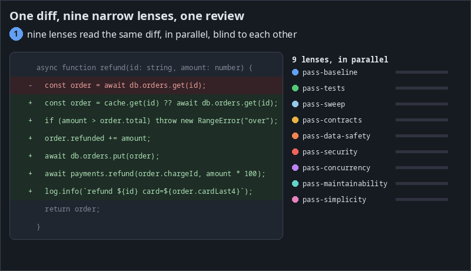

# QuickReview — many narrow reviewers, one review

A single model asked to "review this PR" reads the diff once, from one angle,
and stops when it has found something worth saying. QuickReview does not ask
one reviewer. Each round fans the change out to **many narrow, independent
lens passes**: a dozen or so blank-slate, read-only agents that each look
for one kind of problem and never see each other's output. Their findings
are merged so that one root cause gets one comment, and then an
**adversarial validator re-derives every candidate from the code** before
a single review is posted.

<p align="center">
  
</p>

On a verified-defect benchmark of 185 real PRs it finds **97% of the
high-severity defects and 89% of all 520**, against 67% for the strongest
third-party configuration we measured. That recall costs more: about $2 and
17 minutes per PR, where the other tools take $0.07–0.53 and one to two
minutes ([Benchmarks](#benchmarks)).

Around the review sits a small, deterministic TypeScript daemon with no LLM
in its hot path. It receives GitHub App webhooks, runs an authoritative
reconcile poll, keeps one sticky **pi** coding-agent session per PR, and
posts as *your* GitHub App through one gated mutation path. It runs on your
infrastructure, under your keys.

**Status: honest beta.** The reviewer has run in production continuously
since mid-August 2026 on a busy commercial repository, and its review
behaviour (severity ladder, CI gate, recheck discipline, feedback loop) is
battle-tested there. The *packaging* for third parties, this repo, is young:
expect rough edges in setup. `dry_run = true` is the shipped default, so a
fresh install never posts anything.

## How a review works

1. **Plan the lenses by explicit rules.** Plain code, not a model, reads the
   changed files and the PR text and writes the pass plan. Every planned lens
   carries the reason it was planned (a path, a pattern in the added lines, a
   size, a claim in the PR description). The PR's session may add a lens or
   raise one to a higher reasoning tier, with a stated reason; it may never
   drop one.
2. **Fan out isolated lenses.** Each pass is a leaf agent with read-only
   tools, the diff and a worktree at the exact head. None can see another
   pass, spawn agents, or run your code. A round typically runs a dozen or so:
   - **on every PR:** `pass-baseline` (correctness, claimed invariants,
     sibling sites), and on every code change `pass-tests` (tests, mocks and
     fixtures the change breaks);
   - **per file:** `pass-sweep`, one pass per group of changed files, reading
     line by line for local slips, plus a coverage check that sends a
     targeted sweep to any changed source file no lens commented on;
   - **base against head:** `pass-behaviour-delta` on modified and deleted
     lines where existing behaviour is at risk;
   - **code quality:** `pass-maintainability`, `pass-duplication`,
     `pass-abstraction` and `pass-consistency`, plus `pass-style` and
     `pass-lint-conformance` when the repo writes a style guide or CI lints;
   - **judgment:** `pass-simplicity`, `pass-placement`, `pass-intent` (the
     diff against what the PR text says), `pass-backcompat`;
   - **content-triggered sub-lenses**, each a narrow procedure that fills one
     table: `pass-widened` (every consumer of a changed predicate),
     `pass-claims` (every checkable claim in the PR text), `pass-bounds`,
     `pass-concurrency`, `pass-deferred`, `pass-roundtrip`, `pass-rollout`;
   - **domain lenses by path:** `pass-security`, `pass-data-safety` and
     `pass-prod-risk` at high reasoning, `pass-contracts`, `pass-delivery`,
     `pass-ui`, `pass-statelessness`.
3. **Merge duplicates.** Code groups likely duplicates by file, lines,
   shared identifiers and fix target; the validator decides merge or split
   with the code in view. One root cause becomes one comment anchored at its
   cause, with the other sites listed in its body
   ([docs/duplicate-merge.md](docs/duplicate-merge.md)).
4. **Validate.** `pass-validate` receives every candidate and re-derives it
   by reading the code: it checks the anchor, the severity and the evidence,
   and keeps, demotes, doubts or kills each one from a closed vocabulary.
   Lenses are told that a plausible but wrong finding costs more than a
   missed nit.
5. **Post one review.** Severities map to tags by fixed rules (any surviving
   blocker means REQUEST_CHANGES, otherwise APPROVE; a contrived trigger never
   blocks), and the review posts through the gate. Every candidate, posted or
   not, lands in a per-finding reasoning record.

The lens catalogue with each lens's trigger and severity cap is in the
[QuickReview report](bench/aacr/paper/quickreview.pdf) (§3); the selection
code is `packages/pi-plugin/src/heuristics.ts` and `src/dispatch.ts`.

## Benchmarks

Recall is the headline: a review that misses the defect has failed,
whatever else it does. Precision, cost and time sit beside it, because that
is where QuickReview pays. Its rows are the frozen build of 2026-10-04
(`gpt-6.1-sol`, shipped defaults, one review per PR). The third-party tools
we ran ourselves used the best configuration we found for each, the
OpenAI-based ones on the same model, under the same judge on the same PRs.
Costs are list prices; on a ChatGPT plan they are quota, not a bill.

**Verified defects on AACR-Bench (185 PRs, 10 languages, 520 defects each
verified in the code).** AACR-Bench's own reference comments are mostly
not real problems (the reviewers of the final comparison score 4–11% recall
against them), so we built a key of real defects and a judge for it. A
partly found defect counts ½.

| Reviewer | High (90) | High + medium (235) | All (520) | Comments correct | $/PR | Median min/PR |
|---|---|---|---|---|---|---|
| **QuickReview** | **87.5 (97%)** | **222 (94.5%)** | **461 (89%)** | 92% | 2.06 | 17.5 |
| pi-review panel (high) | 80 (89%) | 199 (85%) | 347.5 (67%) | 89% | 0.27 | 1.8 |
| Claude Code (Opus 5.5) | 72.5 (81%) | 177.5 (76%) | 324.5 (62%) | 81% | 0.20 | 0.7 |
| open-code-review (high) | 63.5 (71%) | 165.5 (70%) | 298.5 (57%) | 86% | 0.53 | 1.8 |
| Codex CLI (high) | 81 (90%) | 182.5 (78%) | 287 (55%) | 93% | 0.14 | 2.1 |
| OpenCode (+ PR text) | 76 (84%) | 175 (74%) | 263.5 (51%) | 93% | 0.17 | 2.3 |
| PR-Agent | 55.5 (62%) | 125.5 (53%) | 194 (37%) | 76% | 0.07 | 1.9 |

Against the panel, Claude Code and Codex CLI the lead holds at every
severity under a paired bootstrap (for example +8.3 points [+1.9, +14.6] on
high-severity defects over the panel). The price: 6.9 comments per PR, 42%
of them true but minor, and 1.8 times the time and 51% more cost than the
build before the last tuning round. That tuning was mined from the misses on
145 of the PRs; on the 20 PRs kept out of it the frozen build finds 83%.

**Martian's offline benchmark (50 PRs, Core).** Martian scores matches
against about 3.5 "golden" comments per PR and counts every other comment as
a false positive. We audited all of the goldens: only 86 describe a real
defect the PR introduces. One `gpt-6.1-sol` judge scored every row; the
three vendor rows are their published comments re-judged.

| Tool | Precision | Recall | F1 | F2 | Real goldens (86) | $/PR | min/PR |
|---|---|---|---|---|---|---|---|
| **QuickReview** | 16.2 | **65.8** | 26.1 | 40.9 | **75 (87%)** | 2.84 | 26.1 |
| qodo-extended-v2 | 56.2 | 60.1 | **58.1** | **59.3** | 68 (79%) | – | – |
| cubic-v2 | 54.3 | 60.1 | 57.1 | 58.9 | 58 (67%) | – | – |
| open-code-review | 26.7 | 58.9 | 36.8 | 47.4 | 67 (78%) | 0.86 | 3.3 |
| PR-Agent | 41.9 | 36.1 | 38.8 | 37.1 | 46 (53%) | 0.09 | 1.4 |
| claude-code | 36.5 | 41.1 | 38.7 | 40.1 | 45 (52%) | – | – |
| OpenCode | 32.7 | 33.5 | 33.1 | 33.4 | 48 (56%) | 0.19 | 2.4 |

Highest recall and the most real defects found; lowest precision and F1.
QuickReview posts about 12.8 issues per PR against 3.5 goldens, and Martian
counts a real bug missing from its list the same as a false claim. Scaled to
Martian's published judge, its F2 would place 14th–16th of 23. On the 30
held-out PRs it ties qodo-extended-v2 on real goldens (43 of 52).

**Qodo PR-Review-Bench (100 PRs, 580 injected issues: 309 functional bugs,
271 violations of rules written in the repo).** Qodo publishes the vendors'
reviews but no judge, so one `gpt-6.1-sol` judge scored every tool under
Qodo's stated matching rule.

| Tool | Comments/PR | Precision | Recall | F1 | Functional recall | Rule recall | $/PR | min/PR |
|---|---|---|---|---|---|---|---|---|
| qodo-exhaustive | 4.6 | 58.0 | **46.4** | **51.5** | 48.2 | **44.3** | – | – |
| qodo-precise | 3.1 | 68.0 | 35.9 | 47.0 | 36.2 | 35.4 | – | – |
| augment | 2.5 | 67.5 | 29.7 | 41.2 | 49.2 | 7.4 | – | – |
| **QuickReview** | 7.1 | 37.3 | 45.3 | 40.9 | **52.1** | 37.6 | 2.48 | 19.6 |
| OpenCode | 2.6 | 64.9 | 29.0 | 40.0 | 43.7 | 12.2 | 0.20 | 2.3 |
| copilot | 4.2 | 46.8 | 33.6 | 39.1 | 46.3 | 19.2 | – | – |
| open-code-review | 3.5 | 47.1 | 28.1 | 35.2 | 45.6 | 8.1 | 0.46 | 1.9 |
| PR-Agent | 3.4 | 47.2 | 27.2 | 34.5 | 43.7 | 8.5 | 0.10 | 1.2 |

The highest functional-bug recall of the thirteen tools and the second
overall recall; fourth on F1. Five more vendors (greptile, cursor, codex,
sentry, coderabbit) score lower and are in the full table. On the 31 PRs no
tuning or validation touched, recall is 60.3% and F1 53.0, against 51.3 for
qodo-exhaustive on the same PRs.

**Read more.** Two papers carry the method, every table and the threats to
validity: [*Measuring whether a code review finds the real
defects*](bench/aacr/paper/benchmark.pdf) (the defect key, the judge, eight
reviewers; the frozen build in §8.7) and [*QuickReview: a multi-pass
automated code reviewer*](bench/aacr/paper/quickreview.pdf) (design, cost,
stability). Every run behind the tables — each review, verdict and score,
and the charts drawn from them — goes into a Hugging Face dataset and run
archive, to be published after this repository (not out yet),
and [`bench/aacr/README.md`](bench/aacr/README.md#reproduce) shows how to
re-score it with no keys, re-judge it, or re-run the whole benchmark on your
own API keys. Every run is one review per PR, and repeat runs differ by about
±2 found issues per benchmark.

## Why this exists

> Nobody on your team is actually reviewing the volume of code your team now
> produces. The author asks their agent to write the code, the reviewer asks
> their agent to review it, the author replies "address the comments" — two
> humans spending a day as slow message brokers between two AIs. The review
> was already AI on both sides. The dead time was ours.
>
> QuickReview stops pretending. Human judgment moves up a level — "is this
> something we need and want?" — while the machine checks what is checkable:
> conformance, security posture, migration safety, completeness, intent.
> And the whole loop, from the harness to the reviewer's memory to its
> accumulated learnings, runs on your infrastructure under your keys.

The philosophy, short, is in [**MANIFESTO.md**](MANIFESTO.md).

## What it does around the review

What one pull request looks like from request to merge, on GitHub and inside
the reviewer: the trigger, the whole-repo checkout, the repo's own rules, the
review, replies on threads, a deferred issue, and the re-review that checks
each fix.

<p align="center">
  
</p>

- **Reviews on trigger, not on every PR**: a label or a team review-request
  marks a PR; everything else is ignored, and bot-authored PRs never queue.
- **One sticky session per PR**: the same conversation follows the PR through
  pushes, author replies, re-reviews and rechecks, with a pinned findings
  ledger that survives context compaction.
- **A hard severity contract**: P0–P2 blockers, questions, nits; a
  reachability gate; a nit-treadmill cap on re-reviews; and a "For a human to
  double-check" section instead of ever handing the review off. Three markers
  carry one meaning each: `[check this]` (a human must verify; the bot cannot
  resolve the thread), `[ask your human]` (the author's AI implementer must
  ask its person) and `[deferred]` (real, not this PR; the reviewer files it).
- **CI-aware approvals**: no green CI at the head means approval is withheld
  (the review posts as a COMMENT), infra failures included.
- **Post-approval rechecks**: pushes, CI completions, base advances and
  author replies wake the same session. Trivial deltas cost a no-op; the only
  allowed transition is APPROVE → REQUEST_CHANGES, never a silent
  re-approve; a hand-resolved merge conflict is audited against both parents.
- **A learning loop**: `[feedback]`-prefixed PR comments and behavioural
  signals (dismissals, merges over a standing block) bite the same day
  through a demotion-only validator addendum; an end-of-day sweep curates
  durable learnings; rubric changes land only by one-click human
  ratification. Feeding them back into your implementing agents'
  instructions is **a human job today**.
- **One mutation gate**: every GitHub write goes through a single gate with
  posting-time guards. In dry-run every would-be mutation is written to
  `state/dryrun/`. There is structurally no code path that dismisses a review.
- **Escalation is optional and ships off** (`[escalation]`): if you turn it
  on, it adds a note *beside* a finished verdict, @-mentioning one configured
  person about one thing. It never asks anyone to review the pull request.
- **Sovereign by construction**: self-hosted daemon, your GitHub App, your
  memory store, rules as files in your repo. On the shipped default the only
  things that leave your infrastructure are **the model call** and the names
  and versions of packages a PR imports, fetched from npm and PyPI so the
  reviewer can read the library's source (`[review] dependency_sources =
  false` closes that). Reviewer memory embeds locally; a hosted embedder is
  an explicit opt-in ([docs/memory-embeddings.md](docs/memory-embeddings.md)).

Optional extras that degrade cleanly when unconfigured: an operator TUI
(`qcr tui`), a Slack concierge, a local "companion" pi session, and the
OpenViking-backed reviewer memory engine.

## Architecture sketch

```
GitHub App webhook (HMAC, dedupe) ─┐
reconcile poll (authoritative) ────┼→ state machine → dispatch (FIFO, lens
verdict watcher (verdict/*.json) ──┘   plan, caps) → RoundOrder
                                          │
                          sessions: tmux + pi, one per PR (+ overseer)
                          worktrees per PR, wake files → inject bridge
                                          │
                          posting via gated scripts (guards + CI gate)
```

`src/` is the daemon (config, gate, GitHub adapter, state machine, dispatch,
guards, recheck, severity, templates, memory seam); `prompts/` + `agents/`
are the frozen prompt seeds (integrity-pinned by tests); `profiles/` carries
repo profiles (house-rule addenda + lens heuristics); `extensions/` are the
pi extensions the sessions run with; `docker/` + `deploy/` are the two
deploy paths. The full picture is in
[docs/architecture/README.md](docs/architecture/README.md).

## Prerequisites

- **Docker**, and the **Compose v2 plugin** (`docker compose`). QuickReview is
  one image; nothing else is installed on your machine.
- **A GitHub account that can create an App** and install it on the repository
  you want reviewed. No personal access token is used, anywhere, and setup
  creates the App from a manifest in one click.
- **On the server route only**: a Linux machine you already reach as
  `ssh <alias>`, with passwordless sudo there, and `ansible-playbook` installed
  on *your* machine (the deploy runs from here, over your ssh).
- **On Windows**: run everything inside **WSL2**. There is no Windows-native
  path, and the setup wizard says so if it cannot find a POSIX user id.

Everything else (the GitHub App, the webhook ingress, the secrets, the
`config.toml`, the memory keys) is something setup *produces*. You choose your
LLM route during setup; both a ChatGPT subscription and an OpenAI API key are
first-class ([docs/llm-setup.md](docs/llm-setup.md)).

## Quickstart

```sh
# once: install `qcr`, the one-file host wrapper the image writes
# (docs/host-wrapper.md); the images are public on ghcr.io
docker run --rm --user "$(id -u):$(id -g)" -v ~/.local/bin:/out \
  ghcr.io/quickchatai/quickreview:<version> install

qcr onboard                           # the whole setup, guided
```

`qcr onboard` is an interactive session: a pi agent talks you through what the
system is while building it, and every act it performs is a named,
deterministic tool whose result you see. It never improvises a shell command,
and it never calls a step done; only the tool's own report does that.

End to end, it checks this machine; asks where the reviewer should live and
which LLM route you want; interviews you for the handful of values only you
can answer; **creates your GitHub App in one click** from this repo's pinned
manifest (the credentials land `0600` in your secrets dir without passing
through your clipboard); wires the webhook ingress; mints and proves the
memory keys; brings the stack up and verifies it in layers, down to a webhook
ping in GitHub's own delivery log; and then **watches a real review happen**
on a PR you label, read out of the dry-run record. Only then does it offer
the go-live flip, once. Finally it hands off to the TUI, where the companion
runs a first-run interview about your repo and your review taste.

It is resumable and re-runnable: a step claimed done is always
**re-verified against reality** before it is believed, and running it again on
a finished installation is a diagnostic rather than a repeat. Every step, every
choice, and what to do when one goes red: [**docs/onboarding.md**](docs/onboarding.md).

### Where the reviewer lives

Both answers are first-class.

- **A VM or server over ssh — the recommendation**, because a reviewer that is
  asleep reviews nothing. Setup rides the same Ansible deploy the maintainers
  use, with every one of its preflights
  ([deploy/ansible/README.md](deploy/ansible/README.md)).
- **This computer** — the whole system in Docker on the machine you are sitting
  at: the released daemon and memory images, pulled, never built. No server to
  own, and it reviews only while that machine is awake
  ([docker/README.md](docker/README.md)).

Switching later costs you none of your answers: re-run the topology step, and
the repo, the App, the labels, the keys and your config are all kept.

### Webhook ingress

GitHub needs an HTTPS URL to deliver to. Four shapes, chosen during setup, with
their trade-offs stated in full in
[docker/README.md](docker/README.md):

| shape | what you get | what it costs |
|---|---|---|
| Cloudflare **quick tunnel** (laptop default) | no account, working in seconds | the hostname rotates on every restart — the daemon re-points the App's webhook URL itself — and there is no SLA |
| **ngrok** | a stable hostname with a reserved domain | an account, and free-tier caps (~20k requests/month, ~1 GB transfer, 1 agent, ~120 req/min) |
| your own **named Cloudflare tunnel** (server default) | a permanent hostname on your domain | a Cloudflare account, a zone, and a connector token |
| **polling only** | nothing exposed at all | up to one poll interval of trigger latency, and author-reply routing plus the `[feedback]` loop go quiet — both are webhook-driven |

Any other HTTPS proxy or tunnel pointed at the webhook port works too.

### Dry-run, and going live

`dry_run = true` ships as the default: the daemon does everything except
execute GitHub mutations, and writes each would-be call to `state/dryrun/`.
The wizard raises the question once, at the end, after you have watched a
review land in that record, and accepting takes an explicit confirmation
phrase. Nothing else in the wizard can move that flag. It is an owner-only
surface ([docs/ownership.md](docs/ownership.md)).

Staying in dry-run is a finished, fully working installation: labelled PRs
get reviewed, the reviewer learns, and every review is a file you can read.
Flip whenever you like, by running that step again or by editing the one line
and restarting the daemon.

### Slack, later

The Slack concierge is deliberately not part of onboarding. Set it up whenever
you like with `npm run slack:setup`, which creates the app, collects the
tokens, picks the channel and patches your config.

## Configuring the reviewer for *your* repo

- **Repo profile** ([docs/profiles.md](docs/profiles.md)): house-rule addenda
  packs, lens-selection heuristics, and per-lens switches (any lens can be
  turned off, given a minimum tier or a severity ceiling). Ship-included:
  `profiles/default/` (the shipped behaviour, the base to extend),
  `profiles/example-django/` (a worked Django profile), `profiles/minimal/`,
  and two leaner review shapes, `profiles/fast/` and `profiles/snappy/`
  (each with its own README). Start from `extends = "default"` and write only what
  differs.
- **Presets**: `[review] preset` names the whole configuration in one word:
  `default`, `max` (every model at its ceiling) or `low` (about half the cost
  and time, lower recall).
- **Ecosystem pre-checks**: the Django migration-collision pre-check is
  selected by the profile (`ecosystem = "django"`); every other ecosystem is
  cleanly off.
- **Owner identity** (`[owner]` in config): name, chat id, GitHub login.
- **Issue sink**: GitHub Issues on your repo (gated + capped), a local
  filesystem tracker, or none.

## What it costs to run

The deterministic daemon is negligible (one small container). The LLM spend
is per review round and scales with diff size and the number of lenses
planned. On the benchmarks above a round averaged $2.06 per PR at list
prices (median $1.87) and a median 17.5 minutes, 4 to 29 times the cost of
the third-party tools measured; a busy repo can consume a serious share of a
ChatGPT subscription's capacity, or real money on the API route. Use
`qcr spend` / `qcr today` to watch usage and `qcr metrics` for
time-to-first-verdict split into a queue leg and a review leg. Start with
the trigger label on a few PRs and widen from there. The recheck, no-op and
nit-cap machinery exists because undisciplined re-review loops are where the
money goes.

## Operating

```sh
qcr onboard                             # guided setup; also a diagnostic
qcr status | today | why <pr> | spend   # CLI over daemon state
qcr metrics [--pr <n>] [--json]         # ttfv, queue/review legs, round stats
qcr tui                                 # operator board
qcr update                              # pull a newer release and re-pin
docker compose logs -f daemon           # daemon logs (laptop route)
```

The TUI reaches the daemon over ssh or against local Docker, per
`config.toml [tui] target`. Working on the code (a clone, `npm ci`, the test
suite, lint and format) is in [CONTRIBUTING.md](CONTRIBUTING.md#running-from-a-clone).

## Roadmap and non-goals

Direction, honestly stated: the posting boundary moves fully into the
daemon; findings telemetry and per-lens unique yield turn into evidenced
lens tuning; the profile ecosystem grows beyond Django; and review history,
clustered by author-side root cause, is driven back into your implementing
agents' instructions, measured by fewer late blockers and fewer rounds.

**Non-goals**, recorded so they cannot be silently unrefused: no rebuilding
GitHub's PR workflow; the reviewer is never asked to run your code; no hard
round budget; the reviewer never reads the implementing conversation; the
fixer and the reviewer are never the same system. Each follows from a belief
in [MANIFESTO.md](MANIFESTO.md).

### The exec boundary, stated so you can falsify it

What enforces "the reviewer never runs your code" is a set of layers: an
allowlist of read-only programs, a veto over writes to git's configuration
and to this system's own policy surface, a re-parse of `bash -c` payloads at
every depth, and a round-boundary integrity check over those files. Each
layer has been tested **by running bypass attempts against it, not by
reading it**. What is guaranteed, what is explicitly *not* (none of it is a
sandbox; the session runs as the daemon's uid), and the probes to try are in
[**docs/exec-boundary.md**](docs/exec-boundary.md), written as claims that
can be shown false. Please try.

## Documentation map

- [MANIFESTO.md](MANIFESTO.md) — the philosophy: what the human decides, what the machine decides
- [docs/architecture/README.md](docs/architecture/README.md) — the process map, the review lifecycle, the sessions, the data model, the safety seams
- [AGENTS.md](AGENTS.md) — orientation for an AI agent editing this codebase
- [docs/onboarding.md](docs/onboarding.md) — the guided setup, step by step
- [docs/github-app-setup.md](docs/github-app-setup.md) — what the GitHub App is, and how to register it by hand
- [docs/llm-setup.md](docs/llm-setup.md) — the two LLM credential routes
- [docker/README.md](docker/README.md) — the compose stack: the daemon and memory images, ingress shapes, version pin
- [deploy/ansible/README.md](deploy/ansible/README.md) — the VM/server route: provisioning, deploy, verification
- [docs/profiles.md](docs/profiles.md) — repo profiles: addenda packs, heuristics, per-lens tuning
- [docs/host-wrapper.md](docs/host-wrapper.md) — the `qcr` host wrapper the release image installs: mounts, token handoff, update
- [docs/plugin.md](docs/plugin.md) — the Claude Code plugin: review, scan and setup skills that call `qcr --json` and refuse an unknown schema version
- [docs/duplicate-merge.md](docs/duplicate-merge.md) — one comment per root cause
- [docs/ownership.md](docs/ownership.md) — the owner-only surfaces (dry-run flag, frozen seeds, ratification)
- [docs/exec-boundary.md](docs/exec-boundary.md) — what stops a review session running your code: the layers, the guarantees, the residual gaps
- [docs/memory-embeddings.md](docs/memory-embeddings.md) — the embedder: local by default, the hosted opt-in
- [bench/aacr/README.md](bench/aacr/README.md) — the benchmark harness: run the production reviewer on public PRs in a locked-down local sandbox
- [docs/provenance.md](docs/provenance.md) — how design decisions are recorded
- [CONTRIBUTING.md](CONTRIBUTING.md) — build, test, and the frozen-seed rule
- [SECURITY.md](SECURITY.md) — reporting vulnerabilities

## Appendix — setting up by hand

`qcr onboard` composes the tools below rather than replacing any of them, so
drift between the guided path and this one is a bug. Do it yourself if you
prefer; re-running the wizard afterwards re-checks every step against reality
without writing anything that already holds.

```sh
IMG=ghcr.io/quickchatai/quickreview:<version>      # after the registry login above

mkdir qcr-bot && cd qcr-bot
docker run --rm --entrypoint tar $IMG -C /opt/qcr -cf - docker-compose.yml docker/tunnel | tar -xf -
mkdir -p ~/.config/qcr/default/secrets
docker run --rm --entrypoint cat $IMG /opt/qcr/config.example.toml \
  > ~/.config/qcr/default/config.toml    # ~10 clearly-marked FILL values:
                                         # repo, app slug/bot login, review
                                         # team/label, owner identity, timezone
                                         # (and [openviking] endpoint = "remote",
                                         # host = "memory", for this stack)
# secrets dir: app_id, app.pem, webhook_secret, then only what your deployment
# needs (tunnel_token, openai_api_key) -- one file each, 0600

cat > .env <<EOF
QCR_VERSION=<version>
QCR_UID=$(id -u)
QCR_CONFIG_HOME=$HOME/.config/qcr/default
QCR_SECRETS_DIR=$HOME/.config/qcr/default/secrets
EOF
docker compose pull --ignore-buildable
docker compose up -d                  # laptop route (docker/README.md)
curl -s http://127.0.0.1:8787/health

# then: point your HTTPS ingress at the webhook port, install the App on your
# repo, create the trigger label, and label a PR — state/dryrun/ fills up.
```

Each piece has its own page: the GitHub App
([docs/github-app-setup.md](docs/github-app-setup.md)), LLM credentials
([docs/llm-setup.md](docs/llm-setup.md)), ingress and sidecars
([docker/README.md](docker/README.md)), and a server instead of
a laptop ([deploy/ansible/README.md](deploy/ansible/README.md), with
`scripts/deploy.sh sync|rebuild|verify`). Slack is optional, any time:
`npm run slack:setup` (from a clone: the image does not carry it yet). **Memory keys**: the server's root key is any 32
random bytes in `<secrets>/openviking_root_key`; the two *user* keys are
issued by the running server, and the wizard's memory step is the only
implementation that mints, places and proves them, so run `qcr
onboard` for that step even if you did everything else by hand. Declining
memory is supported; rounds are unaffected.

`dry_run = true` ships as the default; flipping it is your own act, by hand in
`config.toml` or through the wizard's go-live step, and the daemon re-reads it
on restart.

## Acknowledgements

QuickReview stands on ideas it is glad to name:

- **[Matt Pocock's skills](https://github.com/mattpocock/skills)** — the
  discipline of *processes as versioned files an agent can follow*. This
  system was **built with it**: the wayfinding, spec-writing, ticketing and
  grilling skills in that collection drove the development loop that produced
  this codebase, and shaped how the reviewer's own rules are carried as files.
- **[pi](https://github.com/earendil-works/pi)** — the small-sharp-agent
  philosophy: an agent session is a terminal you can attach to, extensions
  compose instead of frameworks accreting. QuickReview's review sessions are
  pi sessions.
- **[OpenViking](https://github.com/volcengine/OpenViking)** — the memory
  engine behind the reviewer's learning, run on your own infrastructure with
  server-side per-user confinement.
- **[pr-agent](https://github.com/qodo-ai/pr-agent)** — studied closely in
  [docs/pr-agent-comparison.md](docs/pr-agent-comparison.md); several of its
  ideas were adopted by conviction and several deliberately not imported.

## License

MIT (see [LICENSE](LICENSE)); third-party attributions in
[THIRD-PARTY-NOTICES.md](THIRD-PARTY-NOTICES.md).
