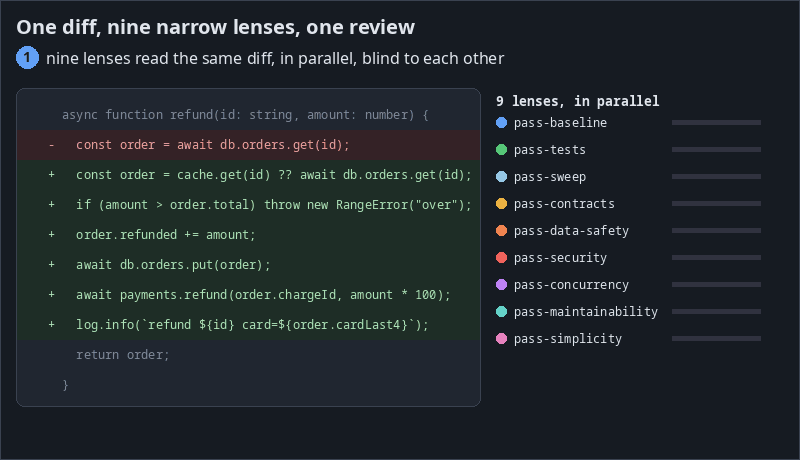
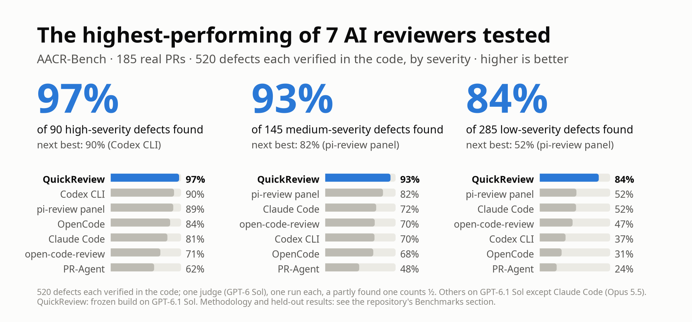

<h1 align="center">QuickReview</h1>

<p align="center">
  <b>An open-source AI code reviewer for your coding agent, your terminal and your pull requests.</b>
</p>

<p align="center">
  <a href="https://github.com/quickchatai/quickreview/actions/workflows/ci.yml"></a>
  <a href="https://www.npmjs.com/package/@quickchatai/quickreview"></a>
  <a href="https://github.com/quickchatai/quickreview/releases/latest"></a>
  <a href="LICENSE"></a>
</p>

<p align="center">
  <a href="#quickstart">Quickstart</a> ·
  <a href="#what-a-review-looks-like">What a review looks like</a> ·
  <a href="#how-a-review-works">How it works</a> ·
  <a href="#benchmarks">Benchmarks</a> ·
  <a href="#run-it-as-a-bot-on-your-pull-requests">Run it as a bot</a> ·
  <a href="#documentation">Docs</a>
</p>

QuickReview reads a change through a dozen or so *lenses*, picked for the
change. A lens is a narrow reviewer that looks for one kind of problem. Every
finding is then checked against the code, and you get one review. It is in
**beta**: setup has rough edges, and a fresh install posts nothing to GitHub.

## Quickstart

Your first review, in Claude Code. Run these two lines in a terminal. They need
Node 22.19 or later, and no Docker.

```sh
npx @quickchatai/quickreview plugin install --to claude   # adds /qcr:review /qcr:scan /qcr:setup
npx @quickchatai/quickreview login                        # once: sign in to a model provider
```

The second line opens the sign-in menu of pi, the coding agent QuickReview runs
on. Pick a provider, sign in, and quit pi. Skip the line if a provider API key
is already in your environment.

Then restart Claude Code, or run `/reload-plugins` in an open session, and type
`/qcr:review` inside a repository. It shows the model, what it will review, and
the price or the spend limit, and it starts only when you say go. The findings
come back by severity, each with a file and a line. A bare `/qcr:review`
reviews your branch's commits against the default branch. Ask for your
uncommitted changes or a pull request and it reviews those instead.

### What to expect

- **You sign in to a model provider, separately.** QuickReview runs on
  [pi](https://github.com/earendil-works/pi), an open-source coding agent that
  is installed with it, and never uses your coding agent's own login. Any
  provider pi supports works, by subscription or API key. With no credential, a
  review stops at the preview, which is free, and says what to do.
- **A review is slow and costs money.** On GPT-6.1 Sol, the model we measured,
  a review took about two dollars and more than fifteen minutes per pull
  request. The six other reviewers we ran on the same pull requests each
  averaged under three minutes and under a dollar ([Benchmarks](#benchmarks)).
  On a subscription plan a review uses quota and adds no bill.
- **It reads your code and runs none of it:** no build, no tests, no scripts
  from the repository ([docs/exec-boundary.md](docs/exec-boundary.md)).
- **It posts nothing to GitHub by default.** Ask it to post and a fresh install
  records the post without sending it: `dry_run = true` is the shipped default,
  and only you turn it off ([docs/ownership.md](docs/ownership.md)).

### In other coding agents

```sh
npx @quickchatai/quickreview plugin install --to codex         # Codex: $qcr:review $qcr:scan $qcr:setup
npx @quickchatai/quickreview plugin install --to copilot       # Copilot CLI: /qcr-review /qcr-scan /qcr-setup
npx @quickchatai/quickreview plugin install --to cursor        # Cursor: /qcr-review /qcr-scan /qcr-setup
npx @quickchatai/quickreview plugin install --to opencode      # opencode: /qcr-review /qcr-scan /qcr-setup
npx @quickchatai/quickreview plugin install --to gemini        # Gemini CLI: /qcr:review /qcr:scan /qcr:setup
npx @quickchatai/quickreview plugin install --to antigravity   # Antigravity: /qcr:review /qcr:scan /qcr:setup
npx @quickchatai/quickreview plugin install --to all           # every one found on this machine
```

Each line ends with what to type in that agent. The installer prints how the
agent picks the plugin up (a restart or a new session) and skips an agent that
is not installed ([docs/plugin.md](docs/plugin.md)). Sign in as above. Cursor
and Antigravity support was written from their plugin docs and has not yet been
run against the real CLIs.

### In your terminal

```sh
npm i -g @quickchatai/quickreview
qcr login              # once: sign in to a model provider
qcr review --preview   # the plan and the price; starts nothing
qcr review             # review this branch's commits against the default branch
```

- `qcr review --uncommitted` reviews your working tree instead.
- `qcr review 123`, or a pull request's URL, reviews a pull request. It needs
  `gh auth login` or a GitHub token.
- `qcr model` shows which model reviews run on and what else you could use.

`qcr` needs Node 22.19 or later. A review whose estimate is under your limit
(two dollars by default) starts without asking, which is why the preview comes
first. When you run it by hand, a review asks where the result should go: the
terminal, a file, or the pull request when that is what you reviewed.

### In pi

```sh
pi install npm:@quickchatai/pi-quickreview   # adds /qcr-review /qcr-scan /qcr-setup
```

Type `/qcr-review` inside a repository. It runs in the background on the login
pi already has, and here a bare `/qcr-review` also covers your uncommitted
changes. It needs pi 1.4.0 or a later release of the same major version
([packages/pi-plugin/README.md](packages/pi-plugin/README.md)).

### On your pull requests

The same reviewer can watch a repository and review its pull requests on its
own. That route needs Docker:
[Run it as a bot on your pull requests](#run-it-as-a-bot-on-your-pull-requests).

### Which model it runs on

You do not have to pick a model. With one model credential, a review runs on
that provider's newest reasoning model. With several, QuickReview picks one and
says which and why. When two are equally good candidates, it asks once and
remembers your answer.

`qcr model` shows the choice, `qcr model use <provider[/model]>` changes it,
and `--model` picks for one run.

What you see before a review starts depends on the model. Only GPT-6.1 Sol
through a ChatGPT sign-in has a measured price: there a review shows a dollar
estimate and stops at twice that figure. On any other model it shows no
estimate, asks once whether to go ahead, and stops at a spend limit, fifteen
dollars by default ([docs/llm-setup.md](docs/llm-setup.md)).

## What a review looks like

An excerpt from a review of an open-source pull request, taken from one of our
benchmark runs. A blocker is a finding that should stop the merge, and a nit is
optional.

> This change batches document and canvas-version deletion work, and the overall direction is sound. This round found that ID-only requests now fail and that deleting by name can erase same-named documents belonging to other tenants. Both optimized paths also retain linear database reads, so changes are required before this is safe to merge.
>
> **Verdict: Changes requested** — 2 blockers, 2 nits.

Each finding is a comment on the line it is about. One of the two blockers:

> [blocker] Scope bulk name resolution to the authenticated tenant
>
> A tenant can delete other tenants’ documents merely by requesting a shared filename. `Document.name` is not globally unique, but this new query returns every matching ID without a tenant predicate; `document_rm()` then replaces the caller’s tenant with each matched document’s owner and removes that document’s database, search-index, file-link, and storage state. Every document selected for deletion must be authorized against the API token’s tenant before any destructive work begins.
>
> _P0 · confidence 0.99 · lens pass-security, pass-baseline, pass-simplicity, pass-backcompat_

The last line gives the severity (`P0` is the worst), the confidence, and the
lenses that reported the finding. Four reported this one, and it became one
comment. In a coding agent or a terminal, the same findings come back as a
list.

## How a review works

<p align="center">
  
</p>

1. **Plan the lenses by rule.** Plain code, with no model involved, reads the
   changed files and the pull request text and picks the lenses.
2. **Fan out isolated lenses.** Each lens works alone, with read-only tools,
   the diff and a checkout of the code. A few run on every code change. The
   rest are picked by path, content and size: security, data safety,
   concurrency, compatibility and more.
3. **Merge duplicates.** Findings with one root cause become one comment.
4. **Validate.** The *validator* re-checks every finding against the code and
   keeps it, lowers it, marks it as a doubt or drops it.
5. **Post one review.** Fixed rules turn what survives into blockers, questions
   and nits, and any blocker means changes are requested. On a pull request
   that is one posted review. In your agent or terminal it is the list you get
   back. Every finding, kept or dropped, is recorded with its reasoning.

## Why it is built this way

A model asked to review a whole change reports what it happened to notice, and
notices something different on the next run. QuickReview bets that a model
asked one narrow question answers it better, and that checking each answer
against the code removes most of the wrong ones. The price is more time, more
money and more comments, some of them true but minor. It pays off when a missed
defect costs you more than a few dollars and a wait.

There is a second reason. When one agent writes the code and another reviews
it, the people in between end up relaying messages. QuickReview takes the
questions a machine can check (is it correct, is it safe, does it do what its
description says) so that people can spend their attention on whether the
change should exist at all ([MANIFESTO.md](MANIFESTO.md)).

## Benchmarks

A design that costs this much has to find more, so we measured it on real pull
requests, with each defect verified in the code.

<picture>
  <source media="(prefers-color-scheme: dark)" srcset="docs/media/bench-hero-dark.png">
  
</picture>

On 185 real PRs with 520 defects each verified in the code, QuickReview on
GPT-6.1 Sol finds **97% of the high-severity defects, 93% of the medium and
84% of the low**; at each severity the best of the six other reviewers we ran
finds 90%, 82% and 52%. On the same model it also finds more than the model
maker's own reviewer at every severity: against Claude Code's `/code-review`
on Claude Opus 5.5 and against Codex CLI on GPT-6.1 Sol. That recall costs
more: about $2 and 17.5 minutes per PR, where the other tools take $0.07–0.53
and 0.7–2.3 minutes ([Benchmarks](BENCHMARKS.md)).

QuickReview is weaker elsewhere: it writes more comments, and it has the lowest
precision on two other public benchmarks. Those results, the pull requests kept
out of tuning, and every table and chart are in [BENCHMARKS.md](BENCHMARKS.md).
Every run is public, with reviews, verdicts and answer key, in the Hugging Face
dataset [quickchatai/quickreview-bench](https://huggingface.co/datasets/quickchatai/quickreview-bench)
(DOI [10.57967/hf/11598](https://doi.org/10.57967/hf/11598)), and each number can be recomputed from it.

## Run it as a bot on your pull requests

QuickReview can also run as a small always-on service that reviews the pull
requests of a repository you choose. It runs on your own machine or server,
with your GitHub identity and your model credential.

<p align="center">
  
</p>

- **It reviews when asked.** Put the trigger label on a pull request
  (`AI review requested` unless you rename it), or request a review from the
  team it watches. One session then follows that pull request through pushes
  and re-reviews, and keeps track of what it raised.
- **It starts in dry run.** Each review it would post is saved for you to read,
  and nothing reaches GitHub. Going live is its own step, after you have
  watched one review.
- **It stays on your infrastructure.** Only the model call and the names of
  packages a pull request imports leave it.

You need **Docker** with Compose v2, a model credential, and `gh` signed in to
GitHub. On Windows, run it inside **WSL2**. If you installed `qcr` with npm,
start here:

```sh
qcr                  # the home: sign in, connect GitHub, choose a repository
```

A bare `qcr` opens the **home**, a terminal screen. On a first run it is a
short checklist of those three steps, and it skips what is already done. After
that it lists your repository's open pull requests. Review one from there by
hand, or switch on auto-review: the home then sets up the always-on service in
Docker and starts it in dry run ([docs/onboarding.md](docs/onboarding.md)).

Without Node, the image installs its own `qcr`, a wrapper that runs each
command in a container:

```sh
# once: install `qcr`, the host wrapper the image writes (docs/host-wrapper.md);
# the images are public on ghcr.io
docker run --rm --user "$(id -u):$(id -g)" -v ~/.local/bin:/out \
  ghcr.io/quickchatai/quickreview:<version> install
```

`<version>` is the newest
[release](https://github.com/quickchatai/quickreview/releases/latest) without
its `v`: there is no `latest` image tag. The wrapper lands in `~/.local/bin`,
which has to be on your `PATH`. Through the wrapper the home runs in a
container and cannot start Docker itself, so it cannot switch on auto-review.
For that, use the npm `qcr` or set the service up by hand
([appendix](#appendix--setting-up-by-hand)).

The bot posts as you or as a GitHub App:

| | Your own account | A GitHub App |
|---|---|---|
| Setup | nothing to register | register an App ([docs/github-app-setup.md](docs/github-app-setup.md)) |
| A review is | a comment that states its verdict | an approval or a change request |
| Approvals | none | only on green CI; a later recheck can only request changes |
| It hears of changes by | polling | polling, or webhooks |
| Author replies and `[feedback]` comments | not seen | seen, with webhooks |

A comment that starts with `[feedback]` tells the reviewer a finding was wrong
or too picky, and it applies that the same day.

For a review in CI with nothing to host, there is a GitHub Action
([docs/action.md](docs/action.md)). It posts for real on the repository that
installs it.

### Where the reviewer lives

- **This computer**, in Docker ([docker/README.md](docker/README.md)), if it is
  always on, such as a cloud VM. A laptop reviews only while it is awake.
- **A server over ssh**, recommended when your own computer sleeps
  ([deploy/ansible/README.md](deploy/ansible/README.md)).

Polling is the default: the daemon checks GitHub every few minutes and exposes
nothing to the internet. A review can start up to one poll interval late, and
author replies and `[feedback]` comments, which arrive by webhook, do not reach
the reviewer. Webhooks need the GitHub App route and an HTTPS URL
([docker/README.md](docker/README.md)).

## Configuring and running it

- **Repo profiles:** your house rules, which lenses run and per-lens switches,
  as files ([docs/profiles.md](docs/profiles.md)).
- **Security review on demand:** the `qcr:security` label adds the fourteen
  security lenses.
- **State-machine review on demand:** the `qcr:state-machines` label,
  `@<bot> state-machines` or `--state-machines` adds the eight `pass-sm-*`
  lenses, which look for implicit state machines gone wrong: flags that can
  disagree, a status written with no check of the old one, a spinner an
  error leaves on.
- **Presets:** `[review] preset` is `default`, `max` (every model at its
  ceiling) or `low` (about half the cost and time, lower recall).
- **Cost:** the bot is one small container, and the model spend is per review.
  Watch it in the home, which shows today's and this month's spend. Start with
  the trigger label on a few pull requests. What a review cost on each
  benchmark is in [BENCHMARKS.md](BENCHMARKS.md).
- **Operating:** the home shows the bot's state, and `qcr tui` opens the admin
  TUI.
- **Whole-repo scan:** `qcr scan` reviews a whole repository instead of a
  change. It first needs the repository cut into units, and by default a
  Docker sandbox ([docs/profiles.md](docs/profiles.md)).
- **Plugins:** `npx @quickchatai/quickreview plugin update` updates every
  coding-agent install, and `plugin uninstall --from <host>` removes one.
- **Slack:** an optional assistant in Slack is set up with
  `npm run slack:setup` from a checkout of this repository
  ([docs/onboarding.md](docs/onboarding.md#slack-later)).

## Documentation

- **Using it:** [coding agents](docs/plugin.md), [pi](packages/pi-plugin/README.md), [models, credentials and price](docs/llm-setup.md), [repo profiles and the scan](docs/profiles.md), [the GitHub Action](docs/action.md)
- **Running the bot:** [guided setup](docs/onboarding.md), [the GitHub App](docs/github-app-setup.md), [the Docker stack](docker/README.md), [the server route](deploy/ansible/README.md), [the `qcr` wrapper](docs/host-wrapper.md), [the dry-run flag](docs/ownership.md)
- **How it works:** [architecture](docs/architecture/README.md), [the report, with every lens](bench/aacr/paper/quickreview.pdf), [what stops a review running your code](docs/exec-boundary.md), [memory embeddings](docs/memory-embeddings.md), [the manifesto](MANIFESTO.md)
- **How it was measured:** [every benchmark result](BENCHMARKS.md), [the benchmark harness](bench/aacr/README.md)
- **Working on it:** [AGENTS.md](AGENTS.md), [CONTRIBUTING.md](CONTRIBUTING.md), [CODE_OF_CONDUCT.md](CODE_OF_CONDUCT.md), [SECURITY.md](SECURITY.md)

## Appendix — setting up by hand

The setup wizard's steps ([docs/onboarding.md](docs/onboarding.md)) compose
these tools rather than replacing them; re-running one afterwards re-checks it
without rewriting what already holds.

```sh
IMG=ghcr.io/quickchatai/quickreview:<version>
mkdir qcr-bot && cd qcr-bot
docker run --rm --entrypoint tar $IMG -C /opt/qcr -cf - docker-compose.yml docker/tunnel | tar -xf -
mkdir -p ~/.config/qcr/default/secrets      # app_id, app.pem, webhook_secret, one file each, 0600
docker run --rm --entrypoint cat $IMG /opt/qcr/config.example.toml \
  > ~/.config/qcr/default/config.toml       # fill the marked values
# .env: QCR_VERSION, QCR_UID, QCR_CONFIG_HOME, QCR_SECRETS_DIR, QCR_CLONE_DIR (docker/README.md)
docker compose pull --ignore-buildable
docker compose up -d
curl -s http://127.0.0.1:8787/health
```

Then point your HTTPS ingress at the webhook port, install the App, create
the trigger label and label a PR: `state/dryrun/` fills up. The memory keys
are minted by the running server (the wizard's memory-keys steps, 60 and 72,
in [docs/onboarding.md](docs/onboarding.md)); declining memory is supported.

## Star history

<a href="https://www.star-history.com/#quickchatai/quickreview&Date">
  <picture>
    <source media="(prefers-color-scheme: dark)" srcset="https://api.star-history.com/svg?repos=quickchatai/quickreview&type=Date&theme=dark">
    
  </picture>
</a>

## Acknowledgements

- **[Matt Pocock's skills](https://github.com/mattpocock/skills)**: the agent skills used to plan and build this codebase.
- **[pi](https://github.com/earendil-works/pi)**: the coding agent every review session runs on.
- **[OpenViking](https://github.com/volcengine/OpenViking)**: the memory engine behind the reviewer's learning.
- **[pr-agent](https://github.com/qodo-ai/pr-agent)**: studied closely in [docs/pr-agent-comparison.md](docs/pr-agent-comparison.md).

## License

MIT ([LICENSE](LICENSE)); third-party attributions in
[THIRD-PARTY-NOTICES.md](THIRD-PARTY-NOTICES.md).
